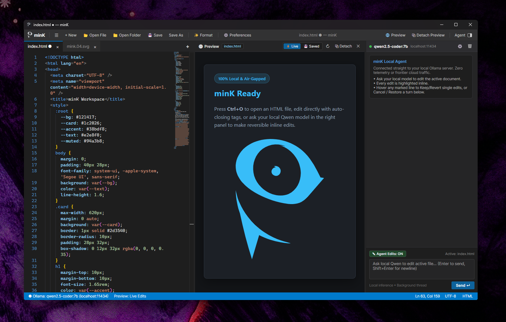

<h1 align=center>minK</h1>
**offline code editor with live web preview.** 



---
**NOT REQUIRED:**
- *Cloud subscription; account of any kind; internet connection; using AI assistance*

**SUPPORTED:**
- *AI-assisted editing using your own Ollama agent responsibly running on local hardware for work, not slop*
---
## Key Features

- **Classic Layout**: Multi-tab file editing, colored line numbers, bracket-pair colorization, and dark styling built on **Avalonia UI (.NET 8)**.
- **Offline Monaco Engine**: Bundled 100% locally (`wwwroot/monaco`) with zero CDN calls. Includes HTML/XML auto-closing tags, CSS/SCSS/JS/TS/JSON workers, Markdown, YAML, and Python syntax highlighting.
- **Detachable Chromium Live Preview**:
  - Toggle instantly between **⚡ Live Edits** (updates in real time as you type across HTML/CSS/JS tabs) and **💾 Last Saved State** (strictly reflects disk state on `Ctrl+S`).
  - One-click **⧉ Detach** into an independent floating window for dual-monitor setups, and **↙ Dock** right back into the split workspace.
- **Local & LAN Ollama Agent (Non-Blocking Background Pipeline)**:
  - Prefilled out of the box for `http://localhost:11434` (`qwen2.5-coder:7b`).
  - Runs 100% of HTTP streaming, JSON parsing, and diff computation off the UI thread so the editor stays responsive while the model thinks and generates.
  - Click the `⚙` icon inside the **Agent** sidebar header (or the Ollama pill on the bottom status bar) to configure any local device or LAN GPU host (e.g. `http://192.168.1.150:11434`) and click **Test & Fetch Models**.
- **Granular & Whole-Turn Reversible + Restorable Edits**:
  - Every AI edit to the active document is highlighted inline with colored green/red line numbers.
  - **Hover** over any highlighted line to open the **Inline Hover Context Menu** (`✓ Keep Edit` | `✕ Revert Edit` | `⟲ Cancel Turn`), revert the entire turn with **⟲ Cancel**, or bring back canceled/partially reverted edits at any time with **↻ Restore**.
- **Essential Preferences (`Ctrl + ,`)**:
  - Clean general settings panel for editor typography, indentation (`2` or `4` spaces), word wrap, minimap, HTML/XML auto-closing tags/brackets, startup layout, and confirmation dialogs.
- **Native Windows Editor & CLI Integration**:
  - Single-instance tab forwarding: double-clicking associated files in Windows Explorer or running `mink <file>` opens files directly as tabs in your active `minK` window.
  - Windows Default Apps (`RegisteredApplications` / `Capabilities`), `Open with > minK`, Explorer file & directory context menus, and `mink` CLI (`PATH`) registration built into the installer.

---

## CLI Usage (`mink`)

Works across **PowerShell**, **Command Prompt (`cmd.exe`)**, and **Git Bash**:

```powershell
mink                      # Launch minK (or focus running window)
mink index.html           # Open file in tab (creates on Ctrl+S if new)
mink index.html app.js    # Open multiple files in tabs
mink .                    # Open current folder in workspace explorer
mink -n project\          # Open in a new minK window
mink --wait file.txt      # Wait until window closes (e.g. git config --global core.editor "mink --wait")
mink --version            # Print version
mink --help               # Print CLI options
```

---

## Keyboard Shortcuts

| Shortcut | Action |
| :--- | :--- |
| `Ctrl + N` | New Tab |
| `Ctrl + O` | Open File(s) |
| `Ctrl + S` | Save Active File |
| `Ctrl + Shift + S` | Save Active File As |
| `Ctrl + B` | Toggle Folder Explorer |
| `Ctrl + ,` | Open `minK` Preferences |
| `Shift + Alt + F` | Format Active Document |
| `Enter` / `Shift + Enter` | Send Chat Prompt / Insert Newline in Chat |

---

## Connecting to a LAN Ollama Server

To connect `minK` to an Ollama server running on another machine on your local network:
1. On the host machine running Ollama, bind Ollama to your LAN interface by setting `OLLAMA_HOST=0.0.0.0:11434` and restarting Ollama.
2. In `minK`, open the **Agent** sidebar and click the `⚙` icon next to the model name (or click the Ollama status pill in the bottom bar), enter `http://<LAN-IP>:11434`, and click **Test & Fetch Models**.

---

## Cross-Platform Architecture & Porting Status

- **UI, Core & IPC**: Pure `.NET 8` + `Avalonia UI 11` (`Skia` rendering), `DiffPlex`, background Ollama streaming, and `System.IO.Pipes` single-instance IPC under the `mink` namespace—all cross-platform out of the box.
- **Web Renderer Abstraction ([`IWebSurface`](minK/Controls/IWebSurface.cs))**:
  - **Windows (`win-x64`)**: Complete out of the box via `WebView2` in [`PlatformWebView.cs`](minK/Controls/PlatformWebView.cs).
  - **Linux & macOS**: The solution compiles natively via the `.NET 8` SDK. To enable the embedded Monaco surface and live HTML preview pane on non-Windows targets, implement an `OperatingSystem.IsLinux()` (`WebKitGTK` / `CEF`) or `OperatingSystem.IsMacOS()` (`WKWebView`) host branch inside [`PlatformWebView.cs`](minK/Controls/PlatformWebView.cs) fulfilling the 6-method [`IWebSurface`](minK/Controls/IWebSurface.cs) interface, and bridge `postToHost` / `message` events in [`wwwroot/monaco/index.html`](minK/wwwroot/monaco/index.html) (`window.webkit.messageHandlers`).

---

## Building from Source

**Prerequisite (all platforms):** [.NET 8 SDK](https://dotnet.microsoft.com/download/dotnet/8.0) (`8.0` or newer).

### Windows (`win-x64`)

```powershell
# Run unit tests & build
dotnet test
dotnet build -c Release

# Publish standalone win-x64 folder
dotnet publish minK/minK.csproj -c Release -r win-x64 --self-contained true -o dist/win-x64

# Compile the Windows Setup package (dist\minK-Setup-1.0.0-win-x64.exe)
# Requires Inno Setup 6: winget install --id JRSoftware.InnoSetup -e --scope user
.\installer\build-installer.ps1
```

### Linux (`linux-x64` / `linux-arm64`)

**1. Install native runtime dependencies** (Avalonia X11/Skia & WebKitGTK headers):

```bash
# Debian / Ubuntu
sudo apt update && sudo apt install -y libx11-6 libice6 libsm6 libfontconfig1 libwebkit2gtk-4.1-dev

# Fedora / RHEL
sudo dnf install -y libX11 libICE libSM fontconfig webkit2gtk4.1-devel

# Arch Linux
sudo pacman -S --needed libx11 libice libsm fontconfig webkit2gtk-4.1
```

**2. Publish a self-contained binary** (use `-r linux-arm64` on ARM64 machines):

```bash
dotnet publish minK/minK.csproj \
  -c Release \
  -r linux-x64 \
  --self-contained true \
  -p:DebugType=None \
  -p:DebugSymbols=false \
  -o dist/linux-x64

chmod +x dist/linux-x64/minK
```

**3. Install to `/opt/minK`, expose the `mink` CLI, and register desktop file associations**:

```bash
sudo rm -rf /opt/minK && sudo cp -r dist/linux-x64 /opt/minK
sudo mkdir -p /opt/minK/Assets && sudo cp mink.04.svg /opt/minK/Assets/mink.svg

# CLI launcher on PATH
sudo tee /usr/local/bin/mink >/dev/null << 'EOF'
#!/usr/bin/env sh
for arg in "$@"; do
  case "$arg" in
    -v|--version|-h|--help|-w|--wait) exec /opt/minK/minK "$@" ;;
  esac
done
nohup /opt/minK/minK "$@" >/dev/null 2>&1 &
EOF
sudo chmod +x /usr/local/bin/mink

# FreeDesktop launcher & "Open With" MIME associations
mkdir -p ~/.local/share/applications
cat > ~/.local/share/applications/mink.desktop << 'EOF'
[Desktop Entry]
Name=minK
Comment=Minimalist local-first web and code editor
Exec=/opt/minK/minK %F
Icon=/opt/minK/Assets/mink.svg
Terminal=false
Type=Application
Categories=Development;TextEditor;IDE;
MimeType=text/html;text/css;text/javascript;application/javascript;application/json;text/markdown;application/xml;image/svg+xml;text/x-python;text/plain;
EOF
update-desktop-database ~/.local/share/applications 2>/dev/null || true
```

### macOS (`osx-arm64` / `osx-x64`)

**1. Publish a self-contained binary** (use `-r osx-arm64` for Apple Silicon or `-r osx-x64` for Intel):

```bash
dotnet publish minK/minK.csproj \
  -c Release \
  -r osx-arm64 \
  --self-contained true \
  -p:DebugType=None \
  -p:DebugSymbols=false \
  -o dist/osx-arm64
```

**2. Package as a macOS `.app` bundle and ad-hoc sign** (required on Apple Silicon):

```bash
APP_BUNDLE="dist/minK.app"
rm -rf "$APP_BUNDLE"
mkdir -p "$APP_BUNDLE/Contents/MacOS" "$APP_BUNDLE/Contents/Resources"

cp -R dist/osx-arm64/* "$APP_BUNDLE/Contents/MacOS/"
chmod +x "$APP_BUNDLE/Contents/MacOS/minK"

cat > "$APP_BUNDLE/Contents/Info.plist" << 'EOF'
<?xml version="1.0" encoding="UTF-8"?>
<!DOCTYPE plist PUBLIC "-//Apple//DTD PLIST 1.0//EN" "http://www.apple.com/DTDs/PropertyList-1.0.dtd">
<plist version="1.0">
<dict>
  <key>CFBundleName</key>
  <string>minK</string>
  <key>CFBundleDisplayName</key>
  <string>minK</string>
  <key>CFBundleIdentifier</key>
  <string>dev.mink.editor</string>
  <key>CFBundleVersion</key>
  <string>1.0.0</string>
  <key>CFBundleShortVersionString</key>
  <string>1.0.0</string>
  <key>CFBundlePackageType</key>
  <string>APPL</string>
  <key>CFBundleExecutable</key>
  <string>minK</string>
  <key>NSHighResolutionCapable</key>
  <true/>
</dict>
</plist>
EOF

# Ad-hoc codesign so macOS Gatekeeper allows local Apple Silicon execution
codesign --force --deep --sign - "$APP_BUNDLE"
```

**3. Install to `/Applications` and expose the `mink` CLI**:

```bash
cp -R dist/minK.app /Applications/

sudo tee /usr/local/bin/mink >/dev/null << 'EOF'
#!/usr/bin/env sh
BIN="/Applications/minK.app/Contents/MacOS/minK"
for arg in "$@"; do
  case "$arg" in
    -v|--version|-h|--help|-w|--wait) exec "$BIN" "$@" ;;
  esac
done
"$BIN" "$@" >/dev/null 2>&1 &
EOF
sudo chmod +x /usr/local/bin/mink
```
